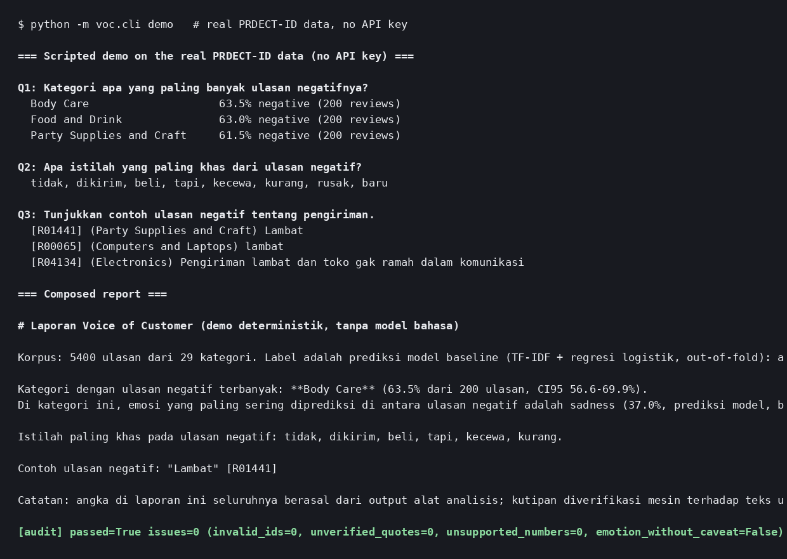

# Voice-of-Customer Agent — Bahasa Indonesia

> Reads Indonesian customer reviews and social/CX comments, labels **sentiment** and **emotion**, and answers a CX team's questions with evidence: category statistics with confidence intervals, complaint themes, distinctive terms, and verbatim quotes whose citations are **mechanically verified** before the report counts as done.



## Real data vs. synthetic data (read this first)

| Part | Data | Status |
|---|---|---|
| Dataset (`data/PRDECT-ID Dataset.csv`) | **Real**: PRDECT-ID (Sutoyo et al., 2022, *Data in Brief*), 5,400 Tokopedia reviews, 29 categories, gold sentiment + emotion labels | Real, copied unmodified from the official repo (MIT); see `data/README.md` |
| Evaluation (`evaluation/`) | Holdout + out-of-fold on that real dataset | Real labels, measured below |
| Test fixtures (`tests/helpers.py`) | Small templated reviews written for unit tests | Fixture only; never used for headline metrics |
| Live agent report quality | Needs an Anthropic API key | **Not measured here** (the loop is tested with a scripted stand-in) |

## Problem

A CX or social-media team in Indonesia drowns in comments written in slang-heavy Bahasa Indonesia
("gak", "bgt", "mantul", elongated words, emoji, prices like "50rb"). Reading them by hand does not
scale, and a dashboard of bare percentages invites a worse failure: a report that quotes a review
nobody wrote, or cites a percentage no analysis produced. This agent is built so the numbers come
from deterministic code and the written report is audited against them.

## What it does

```
CSV (reviews / comments) --> loader (alias headers, ; or ,) --> Indonesian normalisation
      --> baseline classifiers (TF-IDF + logistic regression): sentiment + emotion labels
      --> Corpus tools: overview, category stats (Wilson 95% CI), category ranking,
          distinctive terms (log-odds z), NMF themes, review search
      --> LLM agent (read-only tools) writes the report in ID or EN
      --> mechanical audit: citation IDs exist, quotes are verbatim, % and counts are supported,
          emotion shares carry a "model prediction" caveat
```

- **Code does the numbers.** Parsing, normalisation, classification, statistics and the audit are
  plain tested code. Labels the agent cites are out-of-fold predictions (no review is scored by a
  model that trained on it).
- **The agent adds judgement.** Tools: `get_overview`, `get_model_quality`, `category_stats`,
  `compare_categories`, `distinctive_terms`, `themes`, `search_reviews`, `get_review`. It cannot
  edit data or invent a finding.
- **Privacy by default.** Review text is redacted for Indonesian mobile numbers and e-mail
  addresses before it is shown to a model or printed.
- **Honest labels.** Emotion is hard; every emotion figure the agent reports must carry the
  caveat that it is a model prediction, and the audit enforces it.

## Evaluation (real PRDECT-ID, stratified holdout 80/20, seed 42)

| Task | Accuracy | Macro-F1 | Majority baseline |
|---|---|---|---|
| Sentiment (2 classes) | **95.3%** | 95.3% | 52.2% |
| Emotion (5 classes) | **65.6%** | 62.8% | 32.8% |

Out-of-fold quality of the labels the agent's tools report (5-fold, n = 5,400): sentiment 96.0%
accuracy, emotion 65.2%. Full per-class tables and confusion matrices:
[`evaluation/results/latest.md`](evaluation/results/latest.md)
(reproduce with `python -m evaluation.run_eval`).

**The uncomfortable number, kept on purpose:** a rule that only looks at the star rating
("negative if rating ≤ 3") scores **98.4%** on sentiment in this dataset — *better* than the text
model. In PRDECT-ID the rating and the sentiment label move together almost perfectly. The text
model still earns its place where this agent is meant to work: social-media and CX comment streams
carry **no star rating at all**, and only the text model produces the five emotion labels. Treat
the rating result as a property of this dataset, not as a reason to skip text analysis — and as a
warning to check your own data the same way.

**Report-audit self-test:** the deterministic demo report passes the audit with 0 issues; a
deliberately tampered report (invented 87,3%, fake review ID `R99999`, fabricated quote) fails
with exactly those issues flagged.

## Quick start

```bash
git clone https://github.com/andikapratamazaid/voc-agent-indonesia.git
cd voc-agent-indonesia
pip install -r requirements.txt

python -m voc.cli demo                                        # scripted demo on the real data, no API key
python -m voc.cli analyze "data/PRDECT-ID Dataset.csv"        # deterministic summary

export ANTHROPIC_API_KEY=<redacted>
python -m voc.cli analyze "data/PRDECT-ID Dataset.csv" --agent --question "Kategori apa yang paling bermasalah dan apa buktinya?"
```

Your own export works too: any CSV with a review column (`Customer Review`, `Ulasan`, `Review`, …);
gold labels are only needed for evaluation. See `data/README.md`.

## Tests

```bash
python -m unittest discover -s tests -t .
```

34 tests: Indonesian normalisation (slang, elongation, emoji, price strings, contact redaction),
the loader (both delimiter variants, Indonesian and English headers, unmapped labels, hard
failures), the classifiers, the Corpus statistics (Wilson CIs, planted distinctive term, search,
redaction in retrieved reviews), every report-audit rule (fake IDs, invented percentages, altered
and uncited quotes, emotion caveat), and the agent loop driven by a scripted LLM, including the
deterministic demo report passing its own audit.

**What was not verified:** the live Anthropic adapter (`voc/llm.py`) and anything a real model
does with these tools (question understanding, report quality). Those need your own run; the loop
itself is tested with a scripted stand-in.

## Limitations

- Emotion accuracy (65.6% holdout) is modest — published transformer results on this dataset reach
  roughly 75–80%. This baseline is a floor, not a ceiling, and its outputs are always labelled
  predictions.
- PRDECT-ID is marketplace review data from one platform (Tokopedia). Social-media comments
  (Instagram, TikTok, WhatsApp) differ in style; transfer should be re-measured on a labelled
  social sample before operational use.
- One emotion per review, by dataset design; mixed feelings are forced into a single label.
- A flag or a theme is a prompt for a human CX analyst, not a verdict about a seller or a product.

## Next steps

- Fine-tune an IndoBERT baseline and compare honestly against this TF-IDF floor
- Label a small social-media comment sample and measure cross-domain transfer
- Streaming ingestion for comment exports (per-day VoC digest with the same audit)
- Streamlit dashboard over the Corpus tools

## Related projects

- [BoQ / RAB Cost Checker Agent](https://github.com/andikapratamazaid/boq-cost-checker-agent)
- [Text-to-SQL Analytics Agent](https://github.com/andikapratamazaid/text2sql-analytics-agent)

## Author

**Andika Pratama Zaid** · [LinkedIn](https://linkedin.com/in/andikapratamazaid) · [GitHub](https://github.com/andikapratamazaid)
